# ProjectRecall — Scale-Up Architecture & Executive Requirements Report

---

## Index

| Section | Page |
|---|---|
| **Objective** | 2 |
| **Details of the Project (Opportunity, Problems, Solution, Market)** | 2 |
| **Pre-requisites** | 8 |
| **Complete System Workflow (Current & Expansion)** | 9 |
| &emsp; Part I — Current System (Prototype `0.3.yt`) Workflows A–C | 9 |
| &emsp; Part II — Expansion System (Startup Scale-Up) Workflows D–M | 11 |
| **Visual Workflows** | 15 |
| &emsp; Part I — Current System Visual Diagrams | 15 |
| &emsp; Part II — Expansion System Visual Diagrams | 17 |
| **All Paid API Requirements** | 23 |
| **Requirements (Infrastructure Cost Summary)** | 28 |
| **Explanations of Critical Items** | 30 |
| **Link Of the Current Build** | 33 |

---

# Objective –

ProjectRecall is an AI-powered personal knowledge intelligence and cross-platform recall engine running on top of multi-format media consumption. The core objective is to answer the fundamental problem every digital consumer, student, researcher, and professional faces daily after saving content across social media and web platforms — not just *where* the link was saved, but *what knowledge was inside it, why it matters, and how to recall it instantly when needed.*

The platform automatically ingests, transcribes, summarizes, verifies, embeds, and indexes multi-modal content (YouTube Shorts/Videos, Instagram Reels, TikToks, Twitter/X posts, Facebook media, PDFs, and web articles) forwarded via platform bots (Telegram, WhatsApp, Instagram, Twitter) or saved via Web/Mobile applications. It applies a multi-stage AI ingestion engine (Gemini 2.5 Flash + audio transcription + claim verification) and a multi-tenant hybrid vector search engine (Qdrant + dense/sparse embeddings), allowing users to ask natural language questions across their entire lifetime of saved content and receive sub-second, synthesized answers with exact video timestamps and citations.

The initial funding and migration focus is required to transition from the current working CLI & Telegram prototype (`0.3.yt`, running locally with ChromaDB) to a production-ready, globally distributed, multi-tenant cloud application capable of serving 100,000+ active users worldwide with zero latency and sub-second retrieval.

---

# Details of the Project (Opportunity, problems, solution, Market) -

### The Opportunity

Over 5 billion short-form video views (YouTube Shorts, Instagram Reels, TikTok) occur every single day.
Digital consumers, students, founders, developers, and researchers spend 2–4 hours daily consuming high-density educational tutorials, market analyses, coding guides, life hacks, and research summaries.
Over the last decade, media creation and distribution have been completely digitized and democratized.
Content is no longer scarce. Anyone with a smartphone has instant access to thousands of hours of high-value knowledge from anywhere in the world.
Yet despite bookmarking, liking, or saving dozens of videos and articles every week, users constantly forget what they consumed.
Their personal knowledge retention remains virtually zero.
The issue is not a lack of saving buttons.
The issue is that bookmarks are passive, unindexed, and trapped in isolated platform silos.

### The Problem

Every major platform today (YouTube, Instagram, TikTok, Twitter/X, Facebook) provides a "Save" or "Bookmark" button.
Users see:
• Saved Videos list
• Bookmarked Tweets
• Liked Reels
• Saved Shorts playlists
But these native features create **"Bookmark Graveyards"**.
A user with 1,500 saved reels and shorts cannot answer basic questions:
• *Which video explained the step-by-step framework for setting up Cloud Run auto-scaling?*
• *What were the 3 key tax deduction rules mentioned in that 60-second Instagram Reel I saved 2 months ago?*
• *Which saved video discussed Gemini 2.5 Flash pricing, and what were the exact numbers?*

Current saving features fall short because:
1. **Platform Isolation**: Instagram bookmarks stay in Instagram; YouTube saves stay in YouTube; Twitter bookmarks stay in Twitter.
2. **Title-Only Search**: Native search only matches video titles or uploader usernames — not the actual spoken words, concepts, or sub-topics discussed inside the video.
3. **No Audio/Visual Extraction**: Un-captioned videos or audio-only explanations remain completely opaque to text search.
4. **Zero Conversational Synthesis**: Standard bookmark managers cannot answer complex questions across multiple saved items simultaneously.
5. **High Friction**: Manual note-taking apps (Notion, Obsidian, Readwise) require users to type notes manually, which 95%+ of users abandon within a week.

### Why Existing Analysis Falls Short

Today's bookmarking and read-it-later apps (Pocket, Raindrop.io, Instapaper) are built for static text URLs, not for dynamic multi-modal video/audio media.
They answer questions such as:
• Where is the link I saved?
• When did I bookmark this article?
But they fail to answer the questions that create real knowledge value:
• What was the exact concept taught inside the video?
• How does this saved clip relate to another video I saved 3 weeks ago on a different platform?
• What is the verified factual truth behind the claim made in the video?
• What specific action or code snippet did the video demonstrate?

Two users can save the same 50 videos for completely different reasons. Existing platforms treat them as dead URLs. ProjectRecall treats them as an active, conversational personal knowledge base.

### Why This Market Gap Exists

The obvious question is:
*"If cross-platform AI recall is so valuable, why doesn't Instagram or YouTube build it natively?"*
The answer lies in platform incentives.
Major tech platforms operate within **walled gardens**.
Meta wants users to stay inside Instagram; Google wants users to stay inside YouTube; ByteDance wants users inside TikTok.
None of them have an incentive to build a cross-platform knowledge engine that indexes their competitors' content.
Furthermore, until recently, real-time audio transcription, 3072-dimensional vector embedding generation, and sub-second multi-tenant RAG querying were technically and economically prohibitive at scale.
The industry spent years optimizing feed algorithms. Almost nobody built the cross-platform intelligence layer on top of saved media.
That is the exact gap ProjectRecall addresses.

### Why Now

Three major shifts make ProjectRecall possible right now:
1. **Short-Form Video as Primary Learning**: Video (Shorts, Reels, TikTok) has officially overtaken text articles as the dominant format for learning skills, tutorials, and insights.
2. **Multi-Modal AI Breakdowns**: Modern LLMs (`gemini-2.5-flash`) can process long audio files, transcribe spoken language with near-perfect accuracy, and output structured JSON metadata in milliseconds.
3. **Serverless Vector Architecture**: Managed vector databases (`Qdrant Cloud`) with HNSW indexing and payload filtering enable sub-second semantic search across millions of vector embeddings at minimal cost.

Every user now carries a smartphone with Telegram, WhatsApp, Instagram, or Web access — allowing them to forward any video link to a ProjectRecall bot and immediately convert raw media into searchable knowledge.

### We Are Not Another Note-Taking App

We are not competing with Notion, Obsidian, Evernote, or Apple Notes.
We are building the automated intelligence layer that sits underneath daily media consumption.
Whether a user consumes content on YouTube, Instagram, TikTok, Twitter/X, Podcasts, or Web Blogs is irrelevant to us.
As long as they save or forward content, ProjectRecall generates instant value.
The content creation ecosystem is already mature. We are focused on personal knowledge recall.
Our goal is not to replace note-taking apps — our goal is to become the universal, zero-friction AI memory layer for human digital consumption.

### Our Solution

ProjectRecall is an automated, zero-friction, cross-platform personal AI knowledge engine.
When a user forwards or saves a video/article link to ProjectRecall:
1. **Automated Multi-Format Ingestion**: System parses metadata, extracts transcripts (or downloads audio and transcribes via Gemini if captions are missing).
2. **Structured AI Synthesis**: Gemini extracts a concise summary, key takeaways, automatic tags, and verifies claims against live web search data.
3. **Vector Embedding & Storage**: Content is chunked and embedded into 3072-dimensional vectors, stored in Qdrant Cloud under the user's isolated account.
4. **Natural Language Conversational RAG**: Users can query their knowledge base across Telegram, Web, or Mobile apps:
   - *"Show me all coding tips about FastAPI async routing from my saved videos."*
   - *"What were the exact steps for registering a trademark mentioned in my Instagram saves?"*
The system returns a precise, synthesized answer with direct video links and timestamp references.

### The Revision & Spaced Memory Layer

Beyond search, ProjectRecall introduces automated knowledge retention.
A user saving 50 clips a month quickly forgets early learnings.
ProjectRecall maintains a live Personal Knowledge Map. Using performance history and spaced memory algorithms, the platform automatically:
• Generates weekly knowledge digests summarizing newly saved insights,
• Highlights forgotten concepts at risk of memory decay,
• Reprioritizes key takeaways based on user query patterns,
• Surfaces related cross-platform content when a user researches a new topic.

### Business Model

We operate on a Freemium + Tiered Monthly/Annual SaaS Subscription model:
• **Free Tier ($0/month)**: Up to 20 saved items per month, basic search, Telegram bot access.
• **Pro Tier ($9.99/month or $89/year)**: Unlimited saves, instant audio transcription, deep web-verified summaries, multi-platform bot integration (Telegram, Instagram, Twitter, WhatsApp), priority RAG querying, and Web/Mobile app access.
• **Team / Enterprise Tier ($29/month per seat)**: Shared team knowledge bases, collaborative research indexing, API access for workspace tools.

---

# Pre-requisites –

### What already exists and is working:

The prototype (`0.3.yt`) is live and fully functional locally. The ingestion pipeline extracts YouTube Shorts/Video metadata via `yt-dlp`. Captions are retrieved via `youtube-transcript-api` with fallback to `yt-dlp` audio download (`.m4a`). Audio files are uploaded to Gemini File API and transcribed via `gemini-2.5-flash`. Summarization and tag extraction return structured Pydantic `ContentSummary` JSON. Claim verification runs DuckDuckGo web searches to validate statements. Text chunking generates 128-word overlapping segments. Vector embeddings are generated via `gemini-embedding-2` / `gemini-embedding-001` (3072d vectors) and stored in a persistent local ChromaDB collection (`youtube_shorts_gemini`). Semantic search RAG queries answer natural language questions with source URLs and titles. Exponential backoff retry logic handles 503/429 API errors. CLI Rich interface and Telegram bot integration (`bot.py`) are fully operational.

### What is not yet done and requires scale-up / investment:

• Migration from local file-based ChromaDB to a multi-tenant Qdrant Cloud cluster with payload index filtering (`user_id`) and native hybrid search (dense + sparse).
• Transition from synchronous local CLI execution to a distributed Celery + Redis task queue architecture hosted on Google Cloud Run with multi-region autoscaling.
• Development of multi-platform bot adapters for Instagram, Twitter/X, TikTok, Facebook, and WhatsApp.
• Implementation of Auth0 managed authentication with a unified `linked_accounts` relational schema to link social bot IDs to a single web user account.
• Provisioning of Supabase Pro PostgreSQL for user accounts, billing records, job queue logs, and content metadata.
• Setup of Cloudflare R2 object storage + CDN for zero-egress thumbnail and media asset delivery globally.
• Building the Next.js (React) + Tailwind web application (hosted on Vercel Pro) and Expo React Native mobile application.
• Paid Gemini API tier migration and OpenAI fallback integration (`gpt-4o-mini` + `text-embedding-3-small`).
• Integration of Bright Data rotating residential proxy pool for high-volume yt-dlp video/audio ingestion.
• Production error monitoring via Sentry Team and zero-.env secrets management via Doppler.

---

# Part I — Current System (Prototype `0.3.yt`)

---

## Complete System Workflow (Current)

### Workflow A — User Saves a YouTube Short

User sends a YouTube Shorts URL via CLI (`recall.py`) or Telegram bot (`bot.py`) → `extract_video_id()` regex-parses the URL into an 11-character YouTube video ID (supports `/shorts/`, `/watch?v=`, `youtu.be/`, and mobile formats) → `fetch_metadata()` calls yt-dlp to retrieve title, duration, channel name, and thumbnail URL without an API key → `download_thumbnail()` attempts `maxresdefault.jpg` first, falls back to `hqdefault.jpg`, saves to `recall_db/thumbnails/` → `fetch_transcript()` calls `youtube-transcript-api` to pull captions → **if no captions exist:** `download_audio()` uses yt-dlp to save `.m4a` to `recall_db/audio/` → `transcribe_audio()` uploads file to Gemini File API, polls until `state == ACTIVE` (up to 10 retries, 1–5s each), sends to `gemini-2.5-flash` with verbatim prompt, then deletes both remote and local audio files in a `finally` block → `summarize_transcript()` sends transcript + title to Gemini with `response_mime_type="application/json"` and Pydantic schema `ContentSummary`, returns structured `{summary, tags}` → `verify_with_web()` extracts first claim from summary, runs DuckDuckGo search, returns up to 2 source URLs → `chunk_text()` splits transcript into 128-word chunks with 20-word overlap → `get_embedding()` sends each chunk to `gemini-embedding-2`, returns 3072-dimensional float vector per chunk → `save_content()` stores all chunks with embeddings and unified metadata (video_id, title, summary, tags as JSON string, thumbnail path, web URLs, timestamp, chunk_index) into ChromaDB persistent collection `youtube_shorts_gemini` using cosine similarity.

**Duplicate guard:** Before ingestion begins, `check_duplicate()` queries ChromaDB by `video_id` metadata — if found, the pipeline aborts with a "video already saved" message.

**Error resilience:** `_retry_api_call()` wraps all Gemini calls with exponential backoff (2s → 4s → 8s) on HTTP 503/429 errors, up to 3 attempts.

---

### Workflow B — User Asks a Question (RAG Pipeline)

User sends a natural-language question via CLI or Telegram → `get_embedding(question)` converts the question to a 3072-dim vector using `gemini-embedding-2` → `semantic_search()` runs cosine similarity against all stored chunk embeddings in ChromaDB, returns top 3 matches with metadata → a RAG prompt is constructed: system instructions ("answer only from provided context, cite source URL, say 'I couldn't find that' if not found") + retrieved chunk texts + the user's question → `generate_content()` sends prompt to `gemini-2.5-flash` → response parsed into `{answer, sources}` where sources contain title, URL, and tags from matching chunks → answer delivered to user with source attribution.

**Retry logic:** Same exponential backoff (2s → 4s → 8s) on Gemini 503/429 errors.

---

### Workflow C — Content Listing, Filtering & Deletion

**List:** `list_all_items()` queries ChromaDB for all documents where `chunk_index == 0` (one result per video), returns title, tags, video ID, and saved date → displayed as a formatted list in CLI (via Rich) or Telegram message.

**Filter by tag:** `filter_by_tag()` fetches all `chunk_index == 0` records, deserializes JSON-stringified tags field, performs Python-side substring match against the requested tag.

**Filter by date:** `filter_by_date()` fetches all `chunk_index == 0` records, filters by `saved_at` ISO string prefix matching the requested `YYYY-MM` pattern.

**Delete:** `delete_video()` queries all chunks matching a `video_id` and removes them from ChromaDB in a single operation.

---

## Visual Workflows (Current)

### Save Pipeline — URL parsing, metadata fetch, transcript extraction (captions or audio fallback), AI summarization, chunking, embedding, ChromaDB storage

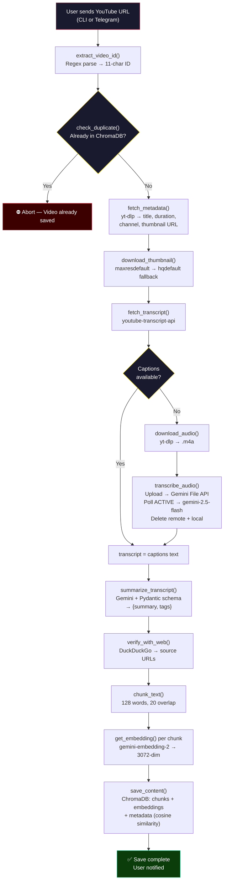

---

### RAG Pipeline — Question embedding, semantic search, LLM-grounded answer generation with source attribution

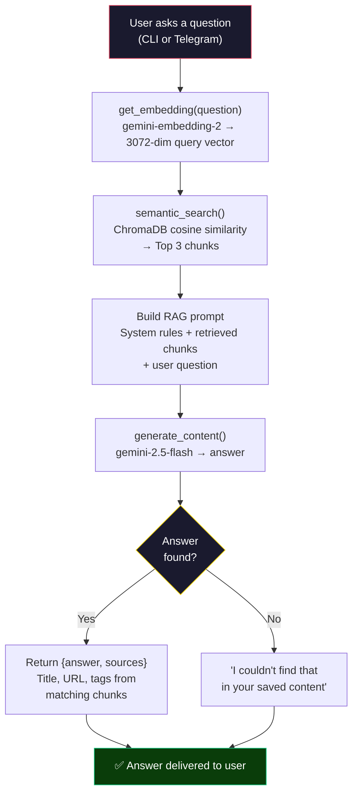

---

### Component Interaction — How CLI, Bot, and core modules connect

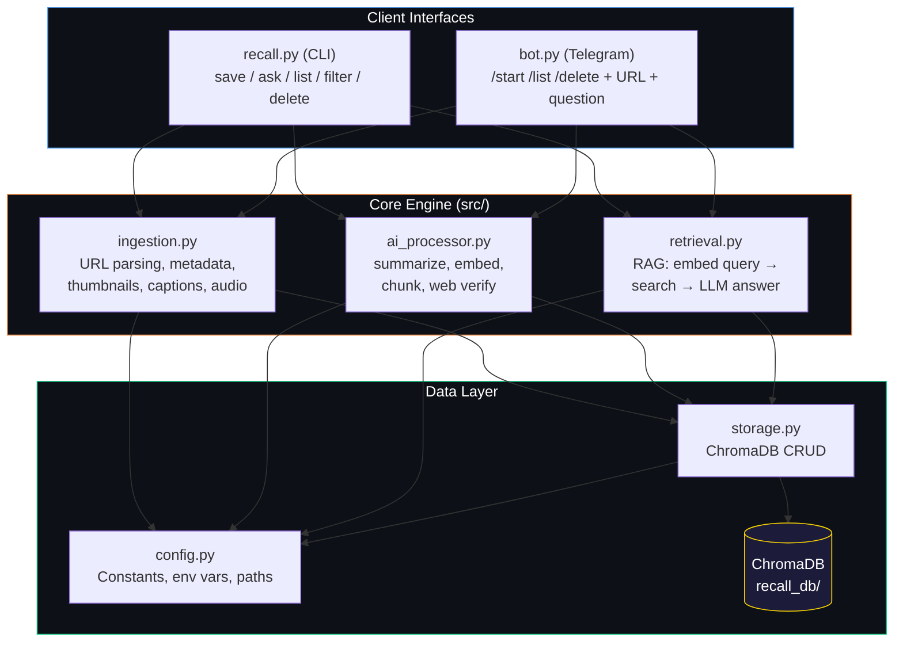

---

# Part II — Expansion System (Startup Scale-Up)

---

## Complete System Workflow (Expansion)

### Workflow D — Multi-Platform Bot Ingestion (Unified Adapter Layer)

User interacts with ProjectRecall from any supported platform (Telegram, Instagram, Twitter/X, Facebook, TikTok, WhatsApp) → each platform has a thin adapter bot that receives the platform-specific message format (Telegram update JSON, Meta webhook payload, X mention event, TikTok webhook, WhatsApp Cloud API message) → adapter normalizes the incoming data into a single internal format: `{user_id, content_url_or_file, source_platform, timestamp, message_type}` → adapter calls the shared Core API (FastAPI REST, same endpoint the web and mobile apps use) → Core API authenticates the request using the linked user identity (see Workflow E) → based on `message_type`, routes to either the save pipeline or the ask pipeline → response is formatted back into platform-specific output by the adapter → delivered to user on the originating platform.

**Key principle:** Each adapter is stateless. No business logic runs inside the bot. All processing, storage, and AI operations happen in the Core API. Adding a new platform means writing only a new adapter (receive format → translate → call API → translate response).

---

### Workflow E — Cross-Platform Identity Linking

New user signs up on web/mobile app → creates account via managed auth provider (Clerk/Supabase Auth) using email, Google, or Apple login → receives a unique internal `account_id` stored in PostgreSQL → user navigates to "Connected Accounts" settings page → selects a platform to link (Telegram, Instagram, Twitter, etc.) → system generates a one-time linking code (6-character alphanumeric, 10-minute expiry, stored in Redis) → user sends the linking code to the ProjectRecall bot on that platform → adapter receives the code + platform-specific user ID → Core API validates the code against Redis → on success: writes a row to `linked_accounts` table in PostgreSQL mapping `{account_id, platform, platform_user_id}` → invalidates the linking code → from this point, any content saved via that platform bot is attributed to the user's unified account → content is accessible from all linked platforms, web, and mobile.

**OAuth alternative:** For platforms that support OAuth (Instagram, Twitter, Facebook), the web app can initiate a standard OAuth flow instead of a linking code — platform grants access token → Core API stores `{account_id, platform, platform_user_id, access_token}`.

---

### Workflow F — Extended Content Ingestion (Beyond YouTube Shorts)

Core API receives a save request with a URL or file attachment → content-type detector identifies the format from URL pattern, MIME type, or file extension → routes to the appropriate ingestion handler:

**Video/Audio branch:** Long-form YouTube videos, Instagram Reels, TikTok videos → yt-dlp (with rotating residential proxy pool for YouTube) or platform-specific APIs → extract metadata + download audio → Gemini transcription → same summarize/chunk/embed pipeline as current. Podcasts and voice memos → direct audio file upload → Gemini transcription → pipeline. Meeting recordings (Zoom/Teams exports) → accept uploaded `.mp4`/`.webm` → audio extraction via ffmpeg → transcription → pipeline.

**Image/Visual branch:** Photos, screenshots, handwritten notes → upload to Gemini vision model → generates text description + OCR extraction → combined text enters summarize/chunk/embed pipeline. Screenshots of tweets, chats, or articles → OCR extracts all visible text → pipeline.

**Document branch:** PDFs → text extraction via `pymupdf` or `pdfplumber` (with OCR fallback for scanned documents) → summarize/chunk/embed pipeline. Word/Excel/PowerPoint → `python-docx`, `openpyxl`, `python-pptx` extraction → pipeline. Web articles/blog posts → URL submitted → `trafilatura` or `newspaper3k` scrapes and cleans article text → pipeline. Ebooks → EPUB parsing via `ebooklib` → pipeline.

**Social/Text branch:** Twitter/X threads → thread URL → scrape/API fetch of full thread → concatenate tweets → pipeline. LinkedIn posts → URL → scrape visible text → pipeline. Forwarded emails → user forwards to a dedicated email address or pastes text → pipeline.

**Unified output:** Regardless of content type, every piece of content enters the same downstream path: `summarize → chunk → embed → store in Qdrant with metadata`. Metadata schema is extended to include `content_type` (video, image, document, social, audio), `source_platform`, and content-specific fields.

---

### Workflow G — Async Job Pipeline (Celery + Redis)

User submits a save request via any client (bot, web, mobile) → FastAPI endpoint validates the request, creates a job record in PostgreSQL with status `QUEUED`, and returns an immediate `202 Accepted` response with a `job_id` → the save task is dispatched to Celery via Redis broker → Celery worker picks up the task → executes the multi-step chain:

**Step 1 — Content fetch:** Download/extract source content (metadata, audio, file) → update job status to `FETCHING`.
**Step 2 — Transcription/OCR:** Generate text from audio/image/document → update job status to `PROCESSING`.
**Step 3 — AI processing:** Summarize with Gemini → extract tags → web verification → update job status to `ANALYZING`.
**Step 4 — Embedding:** Chunk text → generate embeddings via `gemini-embedding-2` → update job status to `EMBEDDING`.
**Step 5 — Storage:** Write chunks + embeddings + metadata to Qdrant (with `user_id` payload filter) + write content record to PostgreSQL → update job status to `COMPLETED`.

**On failure at any step:** Celery retries with exponential backoff (up to 3 attempts) → if all retries fail, job status set to `FAILED` with error details → user notified via their originating platform.

**Progress tracking:** Clients can poll `GET /v1/jobs/{job_id}` for status updates, or receive push notification on completion.

---

### Workflow H — Hybrid Search & Retrieval (Qdrant)

User submits a search query via any client → FastAPI endpoint authenticates and extracts `account_id` → `get_embedding(query)` converts question to 3072-dim vector → Qdrant hybrid search executes:

**Dense vector search:** Cosine similarity against all stored chunk embeddings, filtered by `user_id` payload (per-user isolation) → returns top candidates.
**Sparse vector search:** BM25-style keyword matching on stored chunk text → returns top candidates.
**Fusion:** Reciprocal Rank Fusion (RRF) combines dense + sparse results into a single ranked list → top-K results (configurable, default 5).

**Cache check:** Before executing search, Redis is checked for an identical recent query hash from the same user → if cache hit, return cached results instantly.

Retrieved chunks are assembled into a RAG prompt → sent to Gemini (paid tier, with OpenAI fallback if Gemini unavailable) → grounded answer generated → response includes answer text + source metadata (title, URL, content type, tags, platform saved from) → response cached in Redis (TTL: 1 hour) → delivered to user.

---

### Workflow I — User Authentication & Session Management

**Web/Mobile flow:** User opens app → redirected to managed auth provider (Clerk/Supabase Auth) login page → authenticates via email/password, Google OAuth, or Apple Sign-In → auth provider returns JWT access token + refresh token → client stores tokens securely → every API request includes `Authorization: Bearer <token>` → FastAPI middleware validates JWT signature and expiry → extracts `account_id` from token claims → request proceeds with user context.

**Bot flow:** User sends message to platform bot → adapter extracts `platform_user_id` → Core API looks up `linked_accounts` table for matching `{platform, platform_user_id}` → if found: resolves to `account_id`, request proceeds → if not found: bot responds with onboarding message ("Link your account at projectrecall.com/link") → unauthenticated save requests are held in a temporary queue (Redis, 24h TTL) and attributed once the user links.

**Session management:** Access tokens expire after 15 minutes → refresh tokens (30-day expiry) used to obtain new access tokens without re-login → token rotation on each refresh → revoked tokens stored in Redis blacklist.

---

### Workflow J — Multi-Language Content Processing

User saves content in any language → content type is detected (audio, text, image) → language detection runs on extracted text (using `langdetect` or Gemini's native detection) → detected language stored in content metadata:

**Transcription:** Gemini's multilingual audio model handles transcription in the source language natively — no language-specific model switching needed.

**Summarization:** Gemini prompt includes instruction: "Summarize in the same language as the source content. Additionally produce an English summary if source is non-English." → dual summaries stored: `summary_original` and `summary_en`.

**Embedding:** Gemini embedding model (`gemini-embedding-2`) supports multilingual text natively → embeddings generated from original-language text for best semantic accuracy.

**Search:** User can query in any language → query embedding compared against original-language chunk embeddings → Gemini generates answer in the user's query language, regardless of source content language.

**UI localization:** Web and mobile interfaces support language switching via i18n framework (`next-intl` for web, `react-native-localize` for mobile) → UI strings maintained in JSON translation files → language auto-detected from browser/device settings, with manual override option.

---

### Workflow K — Web & Mobile Client Interaction

**Web app (Next.js):** User opens browser → Next.js server-side renders the dashboard page at the nearest edge location (Vercel/Cloudflare Pages) → initial load includes: saved content grid with thumbnails (served from Cloudflare R2 via CDN), search bar, and sidebar navigation → user searches or browses → API calls to FastAPI backend → results rendered with smooth transitions.

**Mobile app (React Native + Expo):** User opens app → authenticates → home screen shows recent saves and search → share extension allows saving content directly from other apps (YouTube, Instagram, Safari, Chrome) by sharing URL to ProjectRecall → background processing via Celery → push notification (OneSignal) when save completes.

**Real-time sync:** When content is saved from one platform, all connected clients receive a notification → web app uses WebSocket connection to FastAPI for live updates → mobile app receives push notification → bot platforms receive a proactive message (if supported and user has opted in).

---

### Workflow L — Subscription & Billing

New user starts on free tier (5 saves/day, basic search, single platform) → usage counters tracked in Redis, persisted to PostgreSQL daily → when user hits a free-tier limit, response includes upgrade prompt with tier comparison.

**Upgrade flow:** User navigates to billing page → selects plan (Pro/Team) → redirected to Stripe Checkout (or Paddle for tax-handled markets) → completes payment → webhook fires to Core API → `subscriptions` table updated in PostgreSQL → tier-specific limits applied immediately (unlimited saves, all content types, priority processing, all platform connections).

**Usage enforcement:** Every API request checks user's current tier limits via Redis-cached counters → if within limits: proceed → if exceeded: return `429 Too Many Requests` with upgrade prompt → rate limiting at two layers: Cloudflare edge rules (global abuse protection) + application-level per-user quotas (Redis-backed).

---

### Workflow M — Content Moderation Pipeline

Content enters the save pipeline → after text extraction (transcription/OCR/scraping), before AI processing → **Layer 1 — Blocklist check:** content text scanned against a maintained keyword/URL blocklist (stored in Redis for fast lookup) → flagged content marked for review, save paused.

**Layer 2 — AI moderation:** During the summarization step, Gemini prompt includes an instruction to flag harmful, illegal, or spam content → response includes a `moderation_flag` field (clean / review / block) → if `block`: content rejected immediately, user notified → if `review`: content saved but hidden from search results, added to manual review queue in PostgreSQL → admin reviews via internal dashboard.

**Feedback loop:** Moderation decisions logged → used to refine blocklists and prompt instructions over time.

---

## Visual Workflows (Expansion)

### Multi-Platform Unified Adapter Layer — Platform-specific bots translate messages into a common format, hit one shared Core API, responses translated back

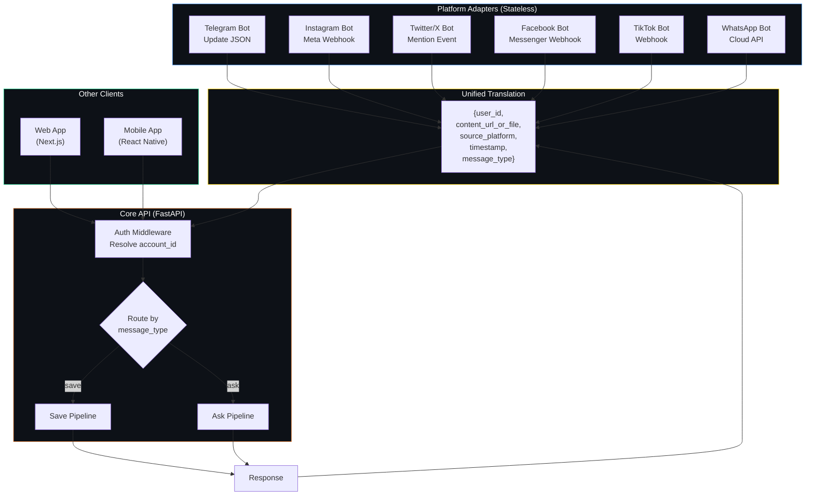

---

### Cross-Platform Identity Linking — One-time code or OAuth links platform accounts to a unified identity

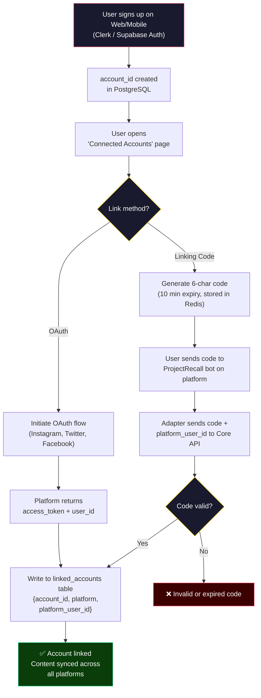

---

### Extended Content Ingestion — Content-type detection routes to specialized handlers, all converge to a single embed/store pipeline

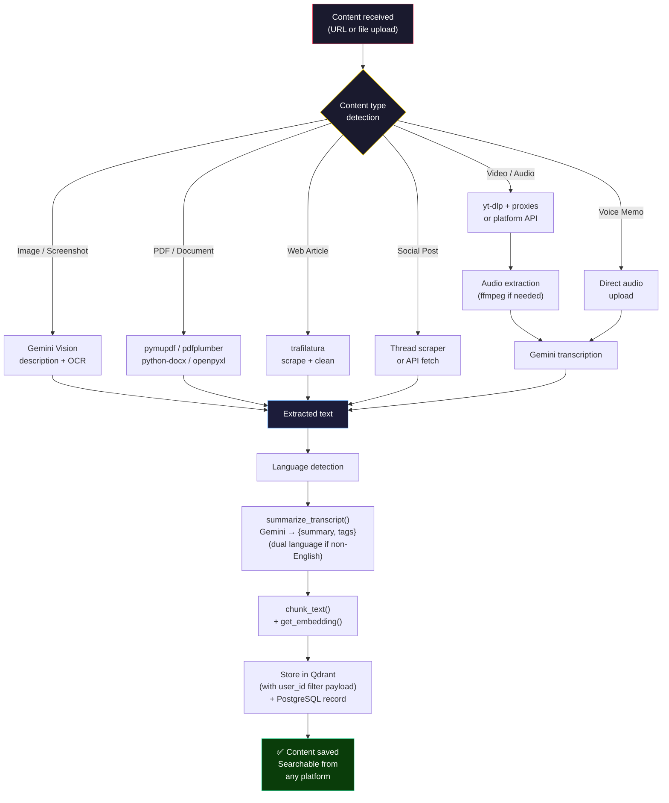

---

### Async Job Pipeline — Celery workers process multi-step save tasks off the request thread with status tracking

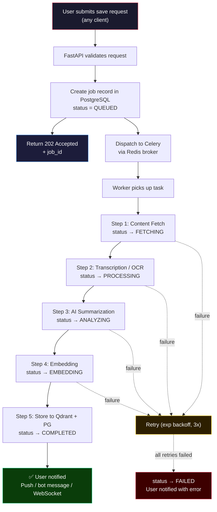

---

### Hybrid Search & Retrieval — Dense + sparse search in Qdrant, Redis cache, LLM answer generation with fallback

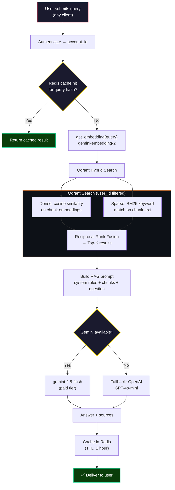

---

### Full System Architecture — How all layers connect from user-facing clients through the Core API to data stores and external services

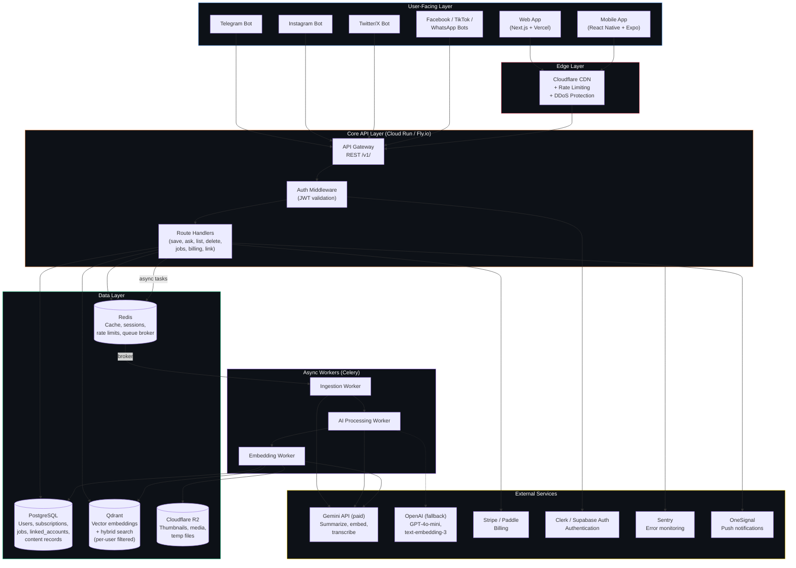

---

### Authentication & Identity Resolution — How requests from different sources resolve to a single user identity

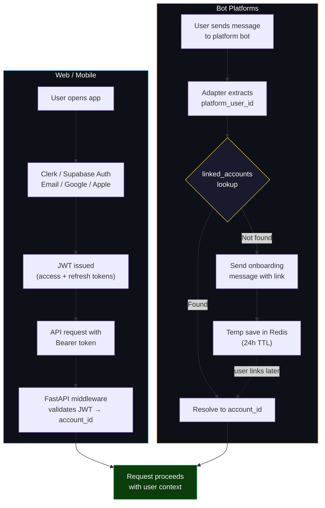

---

### Subscription & Rate Limiting — Two-layer enforcement from edge to application, tier-aware quota management

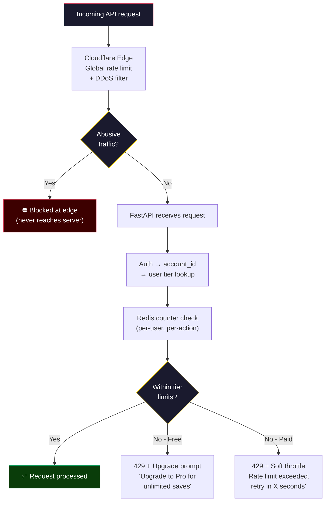

---

### Multi-Language Content Processing — Language detection routes to native multilingual transcription, dual-language summarization, cross-language semantic search, and localized UI delivery

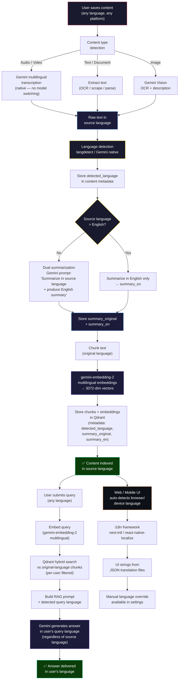

---

# All Paid API Requirements

> All prices are as of July 2026. Verify at each provider's official pricing page before committing budgets — LLM and cloud pricing can shift quarter-to-quarter.

---

### API 1 — Gemini API (Google AI Studio / Vertex AI)

**Purpose:** Three uses in the pipeline. (1) Summarization of all saved content via `gemini-2.5-flash` or its successor — called once per saved item. (2) Audio transcription of videos without captions — called once per audio file, result is the transcript (not re-generated). (3) Multilingual answer synthesis in the RAG pipeline — called on every user question.

**When called:** Summarization and transcription at save time. RAG answers at query time.

**Current status:** Free tier. Must migrate to paid for production — the free tier has no SLA, no data-privacy guarantees, and a rate limit that collapses under any concurrent usage.

**Pricing (paid tier):**

| Model | Input | Output |
|---|---|---|
| `gemini-2.5-flash` (summarize / RAG) | ~$0.075 / 1M tokens | ~$0.30 / 1M tokens |
| `gemini-embedding-001` (vector embeds) | $0.15 / 1M tokens | — |

**Cost estimate at 10K users/month:**
- 10,000 saves × ~1,000 tokens/save = 10M input tokens → ~$0.75 (summarization)
- 10,000 × ~500-word transcript → embed chunks: ~5M tokens → ~$0.75
- 50,000 questions × ~2,000 tokens/question (prompt + context) = 100M tokens → ~$7.50
- **Subtotal: ~$9–15 / month at 10K active users.** Scales linearly.

**Why paid is non-negotiable:** The free tier caps at ~1,500 requests/day. At 10K users each making 5 queries, that's 50,000 requests/day — 33× over the free limit. Beyond rate limits, free-tier requests are used to improve Google's models by default. Paid tier opts you out of training data use — mandatory for a product handling users' personal saved content.

---

### API 2 — OpenAI API (Fallback LLM + Embedding)

**Purpose:** Resilience fallback only. If Gemini is unavailable (outage, rate exhaustion on a burst day), the system routes to `gpt-4o-mini` for answer generation and `text-embedding-3-small` for embeddings. Not the primary path — Gemini handles normal load.

**When called:** Only during Gemini degradation events. Expected usage: <5% of total LLM calls under normal operations.

**Pricing:**

| Model | Input | Output |
|---|---|---|
| `gpt-4o-mini` (fallback RAG) | $0.15 / 1M tokens | $0.60 / 1M tokens |
| `text-embedding-3-small` (fallback embed) | $0.02 / 1M tokens | — |

**Cost estimate:** Kept minimal — a Gemini outage budget of ~$10–20/month covers most incidents. No spend unless Gemini goes down.

**Why include it:** A single-provider AI dependency is a single point of failure. One Gemini outage during peak hours takes your entire product down with zero notice. The fallback costs almost nothing while idle and is the difference between "sorry, our AI is down" and users not noticing anything happened.

---

### API 3 — Qdrant Cloud (Vector Database)

**Purpose:** Replaces ChromaDB for all vector storage, similarity search, and hybrid (dense + sparse) search. Stores all embedding chunks for every user's saved content. Per-user isolation enforced via payload filters (`user_id` field) — no separate collection per user needed.

**When called:** Write on every save (embed chunks stored). Read on every query (hybrid search). High-frequency, must be low-latency.

**Pricing model:** Resource-based (vCPU + RAM + Disk per hour), not per-vector or per-query. Scales with cluster size, not with traffic volume — predictable billing.

| Tier | Cost | Capacity |
|---|---|---|
| Free | $0 | ~1M vectors at 768d; prototype only |
| Standard (1 vCPU, 4GB RAM) | ~$45–60 / month | ~5M vectors at 3072d with quantization |
| Standard (2 vCPU, 8GB RAM) | ~$90–120 / month | ~15M vectors — comfortable for 50K users |

**Cost estimate at launch:** 10,000 users × 50 saved items × 10 chunks/item = 5M vectors. A single `Standard` 1-node cluster (~$50/month) handles this comfortably with scalar quantization enabled (reduces RAM footprint ~4×).

**Why not ChromaDB:** ChromaDB's persistent local file model has no multi-tenant write concurrency, no horizontal scaling, no hybrid search, and no isolation primitives. It is not viable beyond a single-user prototype. Qdrant is purpose-built for exactly this workload.

---

### API 4 — Supabase (Managed PostgreSQL)

**Purpose:** All relational data — user accounts, linked platform identities, job queue records, subscription state, billing records, content metadata (title, URL, content type, timestamp, tags), and usage counters. The source of truth for everything that is not a vector.

**When called:** Every API request that touches user data, saves a content record, updates subscription state, or logs usage. Always-on, low-latency reads.

**Pricing:**

| Tier | Cost | Key limits |
|---|---|---|
| Free | $0 | 500 MB DB, pauses after 1 week inactivity — **not viable for production** |
| Pro | $25 / month | 8 GB DB, 100K MAU, daily backups, never pauses |
| Pro + compute upgrade | $25 + $~50 / month | Larger instance for concurrent query load at scale |

**Cost estimate:** Pro tier at $25/month covers the first 50K users and ~3 years of content records at typical save rates. Compute upgrade (~$50/month extra) recommended once DAU exceeds 5K concurrent users.

**Why paid is non-negotiable:** The free tier **pauses the database after 7 days of inactivity**. A paused database during any user interaction returns errors. For a product where users search their personal knowledge base at any time of day, a 7-day-without-use database pause is guaranteed to hit someone. Additionally: 500 MB fills within the first few thousand users once content records, job logs, and event data accumulate.

---

### API 5 — Auth0 by Okta (Authentication & Identity)

**Purpose:** Managed authentication handling email/password, Google OAuth, Apple Sign-In, MFA, RBAC (role-based access control), session tokens, token refresh, and brute-force protection. The identity hub that links a user's web/mobile account to all their connected platform bots (Telegram, Instagram, Twitter, etc.) via the `linked_accounts` table.

**When called:** Every login, signup, session refresh, and JWT validation. Also consulted at account-link time. Passive JWT verification middleware runs on every API request.

**Why Auth0 over Clerk:** Auth0 is the industry gold standard for enterprise-grade identity — it holds SOC 2 Type II, HIPAA, ISO 27001, and GDPR certifications out of the box. For a product handling users' personal knowledge base content across multiple platforms globally, this compliance posture matters. Auth0 also offers an **"Auth0 for Startups"** program (free access for 1 year for eligible early-stage companies), making it the most cost-effective premium auth option at launch. The attack protection (credential stuffing, breached password detection, anomaly detection) is significantly more mature than Clerk's offering — critical for a product with 100K+ users from all over the world.

**Pricing:**

| Tier | Cost | MAU Limit | Key features |
|---|---|---|---|
| Free | $0 | 25,000 MAU | Social login, passwordless, basic security |
| Essentials | $35 / month | Scales with MAU | RBAC, magic links, SMS MFA |
| Professional | $240 / month | Scales with MAU | Advanced MFA, attack protection, custom DB |
| Startups Program | **$0 for 1 year** | Essentials features | Apply at auth0.com/startups |

**Cost estimate:** Apply for the Startups program immediately — covers the first year free with Essentials features. After Year 1: Free tier at $0 handles up to 25K MAU. Essentials at $35/month handles growth beyond that. Professional tier only needed if adding enterprise SSO connections for a B2B offering.

**Why not custom JWT auth:** Authentication has enormous security surface area — password hashing, brute-force protection, token refresh, social OAuth flows, MFA, account recovery, GDPR-compliant data deletion. Building this correctly takes months and is where early startups introduce the most critical security vulnerabilities. Auth0 solves it in a day with certifications that take years to acquire independently. The ROI is not debatable.

---

### API 6 — Upstash Redis (Cache + Queue Broker)

**Purpose:** Three simultaneous jobs. (1) Celery task queue broker — all async save jobs are dispatched through Redis. (2) Query result cache — identical searches within a 1-hour TTL return instantly without hitting Qdrant or Gemini. (3) Rate-limit counters — per-user save/query quotas enforced at application layer.

**When called:** Every save dispatches a job via Redis. Every query checks Redis cache first. Every API request checks rate-limit counters.

**Pricing (pay-as-you-go):**

| Component | Rate |
|---|---|
| Commands | $0.20 / 100,000 commands |
| Storage | $0.25 / GB |
| Bandwidth | Free up to 200 GB / month |
| Fixed plans | From $10/month for predictable workloads |

**Cost estimate:** At 10K users/month with 5 saves + 10 queries each: ~750K Redis commands/month → ~$1.50. Cache hits and rate-limit checks are cheap. Fixed $10/month plan is more cost-effective once daily usage is consistent.

**Why Upstash specifically:** Scales to zero when idle (no charge during off-hours), serverless model fits perfectly alongside Cloud Run's scale-to-zero hosting, no persistent server to manage.

---

### API 7 — Cloudflare R2 + CDN

**Purpose:** (R2) Object storage for all media assets — video thumbnails, temporary audio files during processing, any user-uploaded images or documents before processing. (CDN) Global edge serving of thumbnails and static assets to users worldwide — this is the primary mechanism making the product "fast from anywhere."

**When called:** R2 write on every save that produces a thumbnail or processes a media file. CDN read on every time a user opens their content library (thumbnails loaded).

**Pricing:**

| Component | Rate |
|---|---|
| R2 Storage | $0.015 / GB-month (10 GB free) |
| R2 Class A ops (writes) | $4.50 / million requests |
| R2 Class B ops (reads) | $0.36 / million requests |
| Egress (all data out) | **$0.00 — free** |
| CDN (via Cloudflare) | Included in free Cloudflare plan |

**Cost estimate:** 10K users × 50 items × avg 50KB thumbnail = ~25 GB storage → ~$0.23/month storage. Reads/writes at 10K saves/day = ~300K Class A ops/month → ~$1.35. Total R2 cost: **~$2/month** at 10K users. Scales very cheaply.

**Why R2 over S3:** AWS S3 charges $0.09/GB egress. For a media-heavy product where thumbnails are loaded every time any user opens the app from any country, egress costs compound fast. R2's zero-egress model eliminates this entirely. At 100K users loading a library of 50 thumbnails each, the egress savings versus S3 are substantial.

---

### API 8 — Google Cloud Run (API + Worker Hosting)

**Purpose:** Hosts the FastAPI backend (API layer) and Celery workers (async processing) as Docker containers. Replaces Railway. Auto-scales per-region based on request volume, scales to zero when idle.

**When called:** Every API request spins up/reuses a container. Celery workers run continuously while jobs are in queue, scale down when queue empties.

**Pricing (Tier 1 regions):**

| Resource | Rate | Free tier |
|---|---|---|
| vCPU | $0.00002400 / vCPU-second | 180,000 vCPU-sec / month |
| Memory | $0.00000250 / GiB-second | 360,000 GiB-sec / month |
| Requests | $0.40 / million | 2M requests / month |

**Cost estimate:** At 10K users/month, assuming 100K API requests and moderate compute: well within the free tier for early stages. At 100K users with sustained load (1M+ requests/month): ~$15–40/month for API + ~$20–50/month for always-on Celery workers with minimum instances. **Total: ~$35–90/month at 100K users.**

**Why Cloud Run over Railway:** Railway has no native multi-region deployment. Cloud Run deploys to any Google Cloud region globally, meaning you can run workers in US, EU, and Asia simultaneously for low-latency saves worldwide. Critical for the "fast from anywhere" requirement.

---

### API 9 — Vercel (Web Frontend Hosting)

**Purpose:** Hosts the Next.js web application. Provides automatic global edge deployment, server-side rendering, and instant cache invalidation. Users loading the web app from Tokyo get the same sub-second load time as users in London.

**When called:** Every web app page load, API route call from the frontend.

**Pricing:**

| Tier | Cost | Key limits |
|---|---|---|
| Hobby (Free) | $0 | No commercial use, limited bandwidth |
| Pro | $20 / seat / month | 1 TB bandwidth included, $20 usage credit |

**Cost estimate:** A solo founder or small team: $20–40/month (1–2 seats). Bandwidth overage at $0.15/GB is negligible for a web app where media is served from Cloudflare R2 CDN, not Vercel.

**When to upgrade from free:** Immediately before public launch. The free Hobby plan prohibits commercial use in its Terms of Service — running a paid product on the Hobby plan is a ToS violation. Pro plan is the minimum for a commercial product.

---

### API 10 — Stripe (Payments & Subscriptions)

**Purpose:** Handles all subscription billing — free-to-paid upgrades, recurring monthly charges, invoice generation, payment failure handling, and webhook delivery (to update subscription state in PostgreSQL). Also handles refunds and cancellations.

**When called:** At subscription creation, renewal (monthly), plan change, cancellation, and payment failure. Not in the hot path of the product — billing events are infrequent.

**Pricing:**

| Component | Rate |
|---|---|
| Payment processing | 2.9% + $0.30 per transaction |
| Stripe Billing (subscription management) | 0.7% of recurring billing volume |
| International cards | +1.5% |
| Disputes / chargebacks | $15 per dispute |

**Cost estimate:** At 1,000 paying subscribers at $10/month: $10,000 MRR → Stripe takes ~$290 (processing) + $70 (billing) = **~$360/month or 3.6% of revenue.** Industry standard.

**Why not build billing yourself:** Payment processing requires PCI DSS compliance, card tokenization, 3D Secure handling, failed payment retry logic, dunning flows, proration on plan changes, and VAT/GST collection in some markets. Stripe handles all of it. Building even half of this from scratch takes months and introduces financial regulatory risk.

---

### API 11 — Resend (Transactional Email)

**Purpose:** Delivers all user-facing emails — account verification, password reset, weekly digest summaries of new saves, payment receipts, subscription notifications, and moderation alerts. High deliverability is critical; self-hosted SMTP gets spam-filtered.

**When called:** At signup, password reset request, weekly (digest), payment events, and moderation actions.

**Pricing:**

| Plan | Cost | Emails / month |
|---|---|---|
| Free | $0 | 3,000 (100/day cap) |
| Pro | $20 / month | 50,000 |
| Scale | $90 / month | 100,000+ |

**Cost estimate:** 10K users receiving 4 emails/month (weekly digest) = 40K emails → **Pro plan at $20/month.** At 100K users: Scale plan at $90/month.

**Why the free tier is insufficient for production:** The 100 emails/day cap means that on any day more than 100 account verifications happen (common after a launch or press mention), new users don't receive their confirmation email and churn. Unacceptable for a growth phase.

---

### API 12 — Sentry (Error Monitoring)

**Purpose:** Captures and alerts on every unhandled exception, 500 error, and performance anomaly across the FastAPI backend, Celery workers, Next.js frontend, and React Native mobile app — in real time. Without this, production bugs are discovered by users, not engineers.

**When called:** Passive — SDK runs inside all services and reports errors automatically. No integration with the hot path.

**Pricing:**

| Plan | Cost | Errors / month |
|---|---|---|
| Developer (Free) | $0 | 5,000 errors, 1 user only |
| Team | ~$26 / month | 50,000 errors, multiple users |
| Business | ~$80 / month | Higher quotas + advanced features |

**Cost estimate:** Free tier during early development. Team plan ($26/month) once you have co-founders or the first employee — 1-user limit on the free tier makes it unusable for a real team.

**Why this is non-negotiable:** At 10K+ users, some fraction of saves will always fail silently — network timeouts, Gemini API edge cases, yt-dlp failures on unusual URLs, Celery worker crashes. Without Sentry, you find out about these only when users report them (slowly, angrily). With Sentry, you see the stack trace before the first user reports it.

---

### API 13 — Doppler (Secrets Management)

**Purpose:** Centralized storage and injection of all API keys and secrets across dev, staging, and production environments — Gemini key, OpenAI key, Stripe key, Supabase connection string, Redis URL, Qdrant key, Resend key, Clerk secret, Sentry DSN. Removes secrets from `.env` files entirely.

**When called:** At container startup (keys injected as environment variables). Not in the request path.

**Pricing:**

| Plan | Cost | Users |
|---|---|---|
| Developer (Free) | $0 | Up to 3 users |
| Team | ~$21 / user / month | Adds RBAC, SSO, 90-day audit logs |

**Cost estimate:** Free tier works for a solo founder. Team plan needed once you add any collaborators who need secret access.

**Why this is non-negotiable:** The project already had one real API key committed to `.env.example` and pushed to a public GitHub repo. That incident cost time to remediate and may have exposed the key for hours. Doppler eliminates `.env` files from the codebase entirely — developers pull secrets from Doppler at runtime, never from files that can be accidentally committed. At scale with multiple API keys across multiple environments, the alternative (manual `.env` management across Cloud Run, Celery, local dev, and staging) becomes an operational nightmare.

---

### API 14 — Rotating Proxy Pool (YouTube/TikTok Ingestion at Scale)

**Purpose:** Distributes yt-dlp download requests across thousands of residential IP addresses so YouTube (and other platforms) do not rate-limit or block the ingestion pipeline. A single server IP making thousands of download requests per day is blocked within hours. A rotating residential proxy pool mimics normal household traffic.

**When called:** Every video save that requires audio download or metadata fetch via yt-dlp. Not needed for direct URL saves (web articles, PDFs) or platform-API-based ingestion.

**Provider:** Bright Data (industry standard; also consider Smartproxy as lower-cost alternative).

**Pricing (Bright Data residential):**

| Plan | Monthly commitment | Bandwidth | Per-GB rate |
|---|---|---|---|
| Pay-as-you-go | None | — | $8.00 / GB |
| Small Business | $499 / month | 141 GB | $3.50 / GB |
| Large Teams | $999 / month | 332 GB | $3.00 / GB |

**Cost estimate:** Each video audio download ≈ 5–15 MB via proxy (audio only, not video). At 10K saves/month with 60% requiring audio download (6,000 × 10 MB avg = 60 GB) → pay-as-you-go: ~$480/month. **Recommended:** Start pay-as-you-go, move to Small Business plan (~$499/month) once audio save volume is proven.

**Note:** This cost only applies to saves requiring audio transcription (no captions available). Saves where YouTube provides captions use the `youtube-transcript-api` directly without any proxy cost.

**Why not just use more server IPs:** YouTube's bot detection operates at the ASN (Autonomous System Number) level, not just the IP level. All traffic from a cloud provider's IP range (Google Cloud, AWS, etc.) is identified as datacenter traffic and throttled or blocked regardless of how many IPs you use. Residential proxies appear as home internet users and are not subject to this classification.

---

# Requirements

## Infrastructure Cost Summary

Costs shown for two stages: **Launch** (0→10K users, first 6 months) and **Scale** (10K→100K users).

| # | Service | Purpose | Launch (0–10K users) | Scale (10K–100K users) | Non-Negotiable? |
|---|---|---|---|---|---|
| 1 | Gemini API (paid) | Summarization, transcription, embeddings, RAG answers | ~$10–20 / mo | ~$100–200 / mo | ✅ Yes |
| 2 | OpenAI API (fallback) | LLM + embedding fallback during Gemini outages | ~$5 / mo (idle) | ~$20 / mo | ⚠️ Strongly recommended |
| 3 | Qdrant Cloud | Vector DB — multi-tenant search + hybrid search | ~$50 / mo | ~$90–120 / mo | ✅ Yes |
| 4 | Supabase Pro | Managed PostgreSQL — users, billing, jobs | $25 / mo | $25–75 / mo | ✅ Yes |
| 5 | Clerk (Auth) | Authentication + identity management | $0 (free up to 50K MRU) | $25 / mo | ✅ Yes |
| 6 | Upstash Redis | Cache + Celery broker + rate-limiting | ~$5–10 / mo | ~$30–50 / mo | ✅ Yes |
| 7 | Cloudflare R2 + CDN | Media storage + global edge delivery | ~$2–5 / mo | ~$10–20 / mo | ✅ Yes |
| 8 | Cloud Run (GCP) | API hosting + Celery workers (multi-region) | ~$0–20 / mo | ~$50–100 / mo | ✅ Yes |
| 9 | Vercel Pro | Next.js web app hosting | $20 / mo | $20–40 / mo | ✅ Yes (commercial use) |
| 10 | Stripe | Subscription billing + payments | 3.6% of revenue | 3.0–3.6% of revenue | ✅ Yes |
| 11 | Resend Pro | Transactional email | $20 / mo | $90 / mo | ✅ Yes |
| 12 | Sentry Team | Error monitoring + alerting | $26 / mo | $26–80 / mo | ✅ Yes |
| 13 | Doppler Team | Secrets management | $0 (free, 1–3 users) | ~$21 / mo | ✅ Yes |
| 14 | Rotating Proxy Pool | YouTube/TikTok ingestion at scale | ~$50–100 / mo (PAYG) | ~$499 / mo (plan) | ⚠️ Required for video saves |

---

### Monthly Fixed Infrastructure Cost (Excluding Gemini/OpenAI, Stripe, Proxy)

| Stage | Fixed monthly cost |
|---|---|
| **Launch (0–10K users)** | ~$148–180 / month |
| **Scale (10K–100K users)** | ~$350–500 / month |

> Gemini, OpenAI, and the proxy pool scale with usage volume, not fixed. Stripe is revenue-percentage, not a cost.

---

# Explanations of Critical Items

**Why the Gemini free tier must be replaced before public launch:**
The free tier allows approximately 1,500 requests per day. At 10K users each making 2 saves and 5 questions per day, that is 70,000 Gemini calls per day — nearly 47× over the free limit. The product fails for everyone the moment this limit is hit. Beyond rate limits, the free tier has no data-privacy guarantees: Google may use free-tier request content to improve its models. User-saved content — notes from videos, personal knowledge base entries — is private data that must not be sent through a consumer-tier API with training-data use rights. Paid tier disables this. This migration is not optional.

**Why Qdrant and not pgvector (Postgres extension):**
At 100K users each saving 50 items with 10 chunks per item, the vector collection grows to 50 million vectors at 3072 dimensions. pgvector in a Postgres instance of reasonable size struggles with ANN (approximate nearest neighbor) search performance at that scale — query latency degrades from milliseconds to seconds. Qdrant's HNSW index, payload filtering architecture, and native hybrid search (dense + sparse in one query) are built specifically for this load. The "no lag, very fast" requirement from the brief is directly addressed by this choice. pgvector is viable for the first 5K users; after that it becomes the bottleneck.

**Why a rotating proxy pool is a non-negotiable infrastructure cost, not a workaround:**
YouTube's anti-bot detection operates at the Autonomous System Number (ASN) level. All traffic originating from cloud provider IP ranges (Google Cloud, AWS, Azure) is classified as datacenter traffic and is throttled aggressively — regardless of request rate or volume. A single server IP making yt-dlp requests gets blocked within hours at any meaningful scale. Residential proxy pools route each request through a real household internet connection, bypassing ASN-level classification entirely. This is the industry-standard solution for any at-scale video metadata and audio extraction pipeline. There is no other workable approach at 100K users.

**Why Supabase Pro is non-negotiable and not deferrable:**
The free tier pauses the Supabase database after 7 days without any API activity. The definition of "inactivity" is any 7-day window where no database queries are made. For a consumer product with any users in different timezones, a 7-day gap in queries is possible but unlikely — but during that pause, the first user to interact with the app receives a dead database error. There is no graceful degradation. The product simply fails. The 500 MB storage limit is also a hard ceiling: users, content records, Celery job logs, linked_accounts, and usage counters together exceed 500 MB within the first few thousand users. $25/month eliminates both issues.

**Why the Vercel free tier (Hobby plan) cannot be used commercially:**
Vercel's Terms of Service explicitly prohibit commercial use on the Hobby plan. Operating a paid subscription product on the Hobby plan is a ToS violation that Vercel has enforced in the past, including account termination without notice. Given that the web app is the primary user-facing surface, a sudden account termination would take the entire product down. The Pro plan at $20/seat/month is the correct entry point for any commercial deployment.

**Why Doppler specifically addresses a known project vulnerability:**
This project previously had a real API key committed to `.env.example` and pushed to GitHub. The root cause is the `.env` file workflow itself — secrets stored in files that live on disk next to the codebase are always one `git add .` away from being committed. Doppler removes secrets from the filesystem entirely. Developers authenticate to Doppler with SSO; the CLI injects secrets as environment variables at runtime without writing any files. Cloud Run and Celery workers pull secrets from Doppler at startup. No `.env` file ever exists in the repository or on any developer's machine in plaintext. This is the direct, architectural fix to the vulnerability that already occurred once.

**Why Cloudflare R2 over AWS S3 for a globally distributed user base:**
AWS S3 charges $0.09 per GB of egress. Every time a user loads their content library, every thumbnail image makes an egress request from S3. At 100K users each loading a library of 50 thumbnails averaging 80KB: 100,000 × 50 × 80KB = 400 GB egress per load cycle. At $0.09/GB that is $36 per full library load across all users — a cost that compounds with every session. Cloudflare R2 charges $0.00 for egress, paired with Cloudflare's CDN which caches assets at edge locations globally so most thumbnail loads never even hit R2. For a media-heavy, globally-distributed product, this is not a minor cost optimization — it is a fundamental architectural decision that makes the cost model viable at scale.

---

### API 15 — Claude Pro (Anthropic)

**Purpose:** Primary AI pair-programming and architecture assistant for building and maintaining the ProjectRecall codebase — writing FastAPI routes, Celery tasks, Qdrant integration, platform adapter bots, debugging complex pipeline failures, and reviewing code before production deployments. Claude's extended context window (200K tokens) is particularly valuable for holding the entire codebase in context during complex refactors.

**When called:** Developer-facing tool. Not in the product's runtime path. Used during every development session.

**Pricing:**

| Plan | Cost | Capacity |
|---|---|---|
| Free | $0 | Limited usage, no priority access |
| Pro | $20 / month ($17/mo annual) | Full access, Claude Code, priority queuing |
| Max 5x | $100 / month | 5× usage limits of Pro |
| Max 20x | $200 / month | 20× usage limits of Pro |

**Cost estimate:** Pro at $20/month covers a solo founder's development needs. Upgrade to Max tiers only if hitting rate limits during heavy build phases.

**Why it's in this document:** Coding assistant subscriptions are a real, recurring infrastructure cost for any serious startup. Not listing them creates a gap in the actual monthly spend. Claude Code + Claude's architecture reasoning capabilities directly accelerate the speed of building this product — at $20/month it is the highest-ROI line item in this entire document.

---

### API 16 — Antigravity Pro (Google AI Pro)

**Purpose:** The agentic IDE platform used to build ProjectRecall — this document itself was produced using Antigravity. Provides AI-powered code generation, multi-file editing, browser automation, terminal control, and long-horizon task execution directly inside the development environment. Complements Claude Pro: Antigravity handles agentic file operations and system-level tasks; Claude handles deep architectural reasoning and code review.

**When called:** Developer-facing. Used during every development session alongside Claude Pro.

**Pricing (Google AI subscription tiers as of July 2026):**

| Plan | Cost | Quota level |
|---|---|---|
| Free | $0 | Rate-limited, refreshes periodically |
| AI Pro | $20 / month | High quota — daily development workloads |
| AI Ultra | $100 / month | 5× Pro limits — heavy agentic workflows |
| AI Ultra Max | $200 / month | 20× Pro limits — maximum throughput |

**Models available:** Gemini 3.1 Pro, Gemini 3.5 Flash, Claude 4.6, GPT-OSS 120B, and others — all accessible within one subscription.

**Cost estimate:** AI Pro at $20/month covers normal development. AI Ultra ($100/month) warranted during intensive build phases with long agentic sessions consuming high token volumes.

**Why both Claude Pro and Antigravity Pro:** They serve different roles in the workflow. Antigravity is the executor — it reads files, writes code, runs commands, interacts with browsers, manages multi-file changes. Claude is the thinker — deep reasoning, architectural decisions, code review, complex debugging. Using both in tandem produces faster, higher-quality code than either alone. Combined cost: $40/month at the base tier.

---

### API 17 — Video Generation AI (Marketing Stack: Runway + HeyGen)

**Purpose:** Producing all marketing video content — product demo videos, social media ads, Instagram Reels, TikTok content, YouTube Shorts teasers, and spokesperson/explainer videos. Not used in the product runtime; developer and marketing tooling.

**Recommended stack (two-tool approach):**

**Runway Gen-4.5** — cinematic creative content: product launch trailers, social media ads, B-roll footage, abstract brand visuals. Best-in-class photorealism and camera motion.

**HeyGen** — spokesperson and localization content: AI avatar explaining ProjectRecall features, product demos recorded once and auto-translated into 40+ languages for global markets, personalized outreach videos.

**Why two tools:** No single tool does both well. Runway produces the highest-fidelity creative video; HeyGen is unmatched for scalable talking-head content and video localization — critical for a multilingual, global product.

**Pricing:**

| Tool | Plan | Cost | Output |
|---|---|---|---|
| Runway | Pro | $35 / month (or $28/mo annual) | 2,250 credits — ~90 sec Gen-4.5 video |
| Runway | Max | $95 / month | 9,500 credits — higher volume production |
| HeyGen | Creator | $29 / month | 600 credits — 1080p avatar videos |
| HeyGen | Business | $149 / month | 1,500 credits — 4K, team collaboration |

**Cost estimate at launch:** Runway Pro ($35/mo) + HeyGen Creator ($29/mo) = **$64/month** for the full marketing video stack. Covers all video needs at early growth stage.

**Practical output at Pro tier:** ~3–5 short-form marketing videos per month (15–30 seconds each) from Runway + 10–15 spokesperson/demo clips from HeyGen. More than sufficient for consistent social media presence at launch.

**Note on Sora:** OpenAI's Sora consumer app was discontinued in April 2026 with API sunset scheduled for September 2026. Do not build marketing workflows on Sora.

---

### API 18 — AWS (Activate Program + Strategic Services)

**Purpose:** AWS is not the primary infrastructure provider for ProjectRecall (Cloud Run / GCP is primary). However, AWS provides two specific strategic values: (1) **AWS Activate** — a startup credit program that can offset significant infrastructure costs during the growth phase, and (2) **Specific AWS services** that have no direct GCP equivalent at the same price/maturity level: CloudFront (as a CDN backup), SES (Simple Email Service as ultra-cheap bulk email), and S3 as a secondary backup destination for critical data.

**AWS Activate Credits:**

| Track | Requirement | Credits |
|---|---|---|
| Founders (bootstrapped) | Company website + <10 years old | $1,000 |
| Portfolio (VC/accelerator-backed) | Affiliation with AWS Activate Provider | Up to $100,000 |
| AI-focused programs | Direct AWS engagement / AI accelerators | $200,000–$300,000+ |

**Strategy:** Apply for AWS Activate Founders immediately ($1,000 free credits, zero barrier). If you raise any funding or join an accelerator, apply for Portfolio track ($100K credits). These credits cover AWS infrastructure costs for 6–18 months depending on usage — essentially free cloud compute during the most cash-constrained phase.

**Specific AWS services worth using:**

| Service | Purpose | Estimated cost |
|---|---|---|
| AWS SES (Simple Email Service) | Bulk/transactional email at massive scale | $0.10 / 1,000 emails (far cheaper than Resend at scale) |
| AWS S3 | Backup destination for Qdrant snapshots + PostgreSQL dumps | ~$0.023 / GB-month |
| AWS CloudFront | CDN redundancy if Cloudflare has an outage | Pay-per-request, typically <$5/mo at this scale |

**When to add AWS SES:** At 100K+ users where email volume exceeds 100K/month, SES at $0.10/1,000 emails ($10 per 100K emails) becomes significantly cheaper than Resend's Scale plan ($90/month for 100K emails). Migrate bulk digest emails to SES at that point while keeping Resend for critical transactional messages (password reset, payment receipts) where deliverability tooling matters.

**Cost estimate (paid services):** If not using Activate credits — AWS SES: ~$1–10/month. S3 backup: ~$5–15/month. CloudFront: ~$0–5/month. **Total: <$30/month for all AWS services.** With Activate credits: **$0 for 6–18 months**.

**Why include AWS alongside GCP:** Single-cloud dependency is a single point of failure at the infrastructure level. Having AWS as a secondary provider for backups and email means a GCP regional outage does not take your backups offline simultaneously. Belt-and-suspenders infrastructure design.

---

# Updated Requirements Table

## Full Infrastructure Cost Summary (All APIs)

| # | Service | Purpose | Launch (0–10K users) | Scale (10K–100K users) | Non-Negotiable? |
|---|---|---|---|---|---|
| 1 | Gemini API (paid) | Summarization, transcription, embeddings, RAG | ~$10–20 / mo | ~$100–200 / mo | ✅ Yes |
| 2 | OpenAI API (fallback) | LLM + embedding fallback | ~$5 / mo idle | ~$20 / mo | ⚠️ Strongly recommended |
| 3 | Qdrant Cloud | Vector DB — multi-tenant hybrid search | ~$50 / mo | ~$90–120 / mo | ✅ Yes |
| 4 | Supabase Pro | PostgreSQL — users, billing, jobs | $25 / mo | $25–75 / mo | ✅ Yes |
| 5 | Auth0 (Essentials) | Authentication + identity management | $0 (Startups program, 1yr) → $35/mo | $35–240 / mo | ✅ Yes |
| 6 | Upstash Redis | Cache + Celery broker + rate-limiting | ~$5–10 / mo | ~$30–50 / mo | ✅ Yes |
| 7 | Cloudflare R2 + CDN | Media storage + global edge delivery | ~$2–5 / mo | ~$10–20 / mo | ✅ Yes |
| 8 | Cloud Run (GCP) | API hosting + Celery workers | ~$0–20 / mo | ~$50–100 / mo | ✅ Yes |
| 9 | Vercel Pro | Next.js web app hosting | $20 / mo | $20–40 / mo | ✅ Yes (commercial) |
| 10 | Stripe | Subscription billing + payments | 3.6% of revenue | 3.0–3.6% of revenue | ✅ Yes |
| 11 | Resend Pro | Transactional email (→ AWS SES at scale) | $20 / mo | $90 / mo → $10 SES | ✅ Yes |
| 12 | Sentry Team | Error monitoring + alerting | $26 / mo | $26–80 / mo | ✅ Yes |
| 13 | Doppler | Secrets management | $0 free tier | ~$21 / mo | ✅ Yes |
| 14 | Rotating Proxy Pool | YouTube/TikTok ingestion at scale | ~$50–100 / mo PAYG | ~$499 / mo | ⚠️ Required for video |
| 15 | Claude Pro | AI coding assistant (development) | $20 / mo | $20–100 / mo | ✅ Yes |
| 16 | Antigravity Pro | Agentic IDE platform (development) | $20 / mo | $20–100 / mo | ✅ Yes |
| 17 | Runway Pro + HeyGen | Marketing video generation | $64 / mo | $64–245 / mo | ⚠️ Marketing essential |
| 18 | AWS (Activate + SES/S3) | Credits + backup + bulk email | $0 (credits) → <$30 / mo | <$30 / mo | ⚠️ Apply immediately |

---

### Total Monthly Cost Estimate (All Services)

| Category | Launch (0–10K users) | Scale (10K–100K users) |
|---|---|---|
| **Infrastructure (fixed)** | ~$148–180 / mo | ~$350–500 / mo |
| **Development tools** | $40 / mo (Claude + Antigravity) | $40–200 / mo |
| **Marketing video** | $64 / mo | $64–245 / mo |
| **AI/LLM (usage-based)** | ~$10–25 / mo | ~$100–220 / mo |
| **Proxy pool (usage-based)** | ~$50–100 / mo | ~$499 / mo |
| **Stripe (% of revenue)** | 3.6% of MRR | 3.0–3.6% of MRR |
| **AWS (with Activate)** | $0 | <$30 / mo |
| **Grand total (excl. Stripe)** | **~$312–410 / mo** | **~$1,053–1,694 / mo** |

> At 1,000 paying subscribers at $10/month ($10K MRR), Stripe takes ~$360. Net cost at that point: ~$670–770/month against $10K revenue — a healthy ~7% infrastructure cost ratio.

---

# Explanations of Critical Items (Updated)

**Why the Gemini free tier must be replaced before public launch:**
The free tier allows approximately 1,500 requests per day. At 10K users each making 2 saves and 5 questions per day, that is 70,000 Gemini calls per day — nearly 47× over the free limit. The product fails for everyone the moment this limit is hit. Beyond rate limits, the free tier has no data-privacy guarantees: Google may use free-tier request content to improve its models. User-saved content — notes from videos, personal knowledge base entries — is private data that must not be sent through a consumer-tier API with training-data use rights. Paid tier disables this. This migration is not optional.

**Why Qdrant and not pgvector (Postgres extension):**
At 100K users each saving 50 items with 10 chunks per item, the vector collection grows to 50 million vectors at 3072 dimensions. pgvector in a Postgres instance of reasonable size struggles with ANN (approximate nearest neighbor) search performance at that scale — query latency degrades from milliseconds to seconds. Qdrant's HNSW index, payload filtering architecture, and native hybrid search (dense + sparse in one query) are built specifically for this load. The "no lag, very fast" requirement from the brief is directly addressed by this choice. pgvector is viable for the first 5K users; after that it becomes the bottleneck.

**Why a rotating proxy pool is a non-negotiable infrastructure cost, not a workaround:**
YouTube's anti-bot detection operates at the Autonomous System Number (ASN) level. All traffic originating from cloud provider IP ranges (Google Cloud, AWS, Azure) is classified as datacenter traffic and is throttled aggressively — regardless of request rate or volume. A single server IP making yt-dlp requests gets blocked within hours at any meaningful scale. Residential proxy pools route each request through a real household internet connection, bypassing ASN-level classification entirely. This is the industry-standard solution for any at-scale video metadata and audio extraction pipeline. There is no other workable approach at 100K users.

**Why Supabase Pro is non-negotiable and not deferrable:**
The free tier pauses the Supabase database after 7 days without any API activity. The definition of "inactivity" is any 7-day window where no database queries are made. For a consumer product with any users in different timezones, a 7-day gap in queries is possible but unlikely — but during that pause, the first user to interact with the app receives a dead database error. There is no graceful degradation. The product simply fails. The 500 MB storage limit is also a hard ceiling: users, content records, Celery job logs, linked_accounts, and usage counters together exceed 500 MB within the first few thousand users. $25/month eliminates both issues.

**Why Auth0 over Clerk for a global consumer product:**
Clerk is excellent for developer experience and Next.js-native integration. However, Auth0 wins on three dimensions that matter more for a globally-distributed product with 100K+ users. First, compliance posture: Auth0 holds SOC 2 Type II, HIPAA, ISO 27001, and GDPR certifications — these become relevant when users in regulated markets (EU GDPR, healthcare-adjacent use cases) ask about data handling. Clerk's certifications are more limited. Second, attack protection: Auth0's breached password detection, credential stuffing protection, and anomaly detection are significantly more mature — at 100K users, automated credential attacks are a certainty, not a possibility. Third, the Startups program: Auth0 offers free Essentials-tier access for one year to eligible early-stage companies. A product at launch phase that qualifies gets enterprise-grade auth at zero cost for the most cash-constrained year. Total decision: better security, better compliance, and cheaper at launch.

**Why the Vercel free tier (Hobby plan) cannot be used commercially:**
Vercel's Terms of Service explicitly prohibit commercial use on the Hobby plan. Operating a paid subscription product on the Hobby plan is a ToS violation that Vercel has enforced in the past, including account termination without notice. Given that the web app is the primary user-facing surface, a sudden account termination would take the entire product down. The Pro plan at $20/seat/month is the correct entry point for any commercial deployment.

**Why Doppler specifically addresses a known project vulnerability:**
This project previously had a real API key committed to `.env.example` and pushed to GitHub. The root cause is the `.env` file workflow itself — secrets stored in files that live on disk next to the codebase are always one `git add .` away from being committed. Doppler removes secrets from the filesystem entirely. Developers authenticate to Doppler with SSO; the CLI injects secrets as environment variables at runtime without writing any files. Cloud Run and Celery workers pull secrets from Doppler at startup. No `.env` file ever exists in the repository or on any developer's machine in plaintext. This is the direct, architectural fix to the vulnerability that already occurred once.

**Why Cloudflare R2 over AWS S3 for a globally distributed user base:**
AWS S3 charges $0.09 per GB of egress. Every time a user loads their content library, every thumbnail image makes an egress request from S3. At 100K users each loading a library of 50 thumbnails averaging 80KB: 100,000 × 50 × 80KB = 400 GB egress per load cycle. At $0.09/GB that is $36 per full library load across all users — a cost that compounds with every session. Cloudflare R2 charges $0.00 for egress, paired with Cloudflare's CDN which caches assets at edge locations globally so most thumbnail loads never even hit R2. For a media-heavy, globally-distributed product, this is not a minor cost optimization — it is a fundamental architectural decision that makes the cost model viable at scale.

**Why the dual Runway + HeyGen video stack rather than one tool:**
No single AI video tool currently handles both cinematic creative content and scalable spokesperson/localization content well. Runway's Gen-4.5 model produces the highest-fidelity photorealistic video in the industry — it is the right tool for product launch trailers, social ads, and abstract brand visuals that need to stop a scroll. HeyGen is in an entirely different category: it excels at AI avatar content, where a founder records themselves once and HeyGen auto-generates translated versions in 40+ languages, or where a product demo script is turned into a polished speaking-head video in minutes. For a multilingual product targeting users globally across Instagram, TikTok, and YouTube, both capabilities are needed. At $64/month combined, the cost is lower than one mid-tier human video editor charging hourly.

**Why apply for AWS Activate immediately:**
AWS Activate Founders requires only a company website and being under 10 years old. It takes 15 minutes to apply and provides $1,000 in AWS credits — no strings attached. If you join any accelerator or raise any funding, the Portfolio track provides up to $100K in credits, covering AWS infrastructure costs for 1–2 years. These credits apply to SES (cheapest bulk email at scale), S3 (cheapest backup storage), and any CloudFront usage. The opportunity cost of not applying is real free money during the most capital-constrained period of the startup. Apply on Day 1.

---

# Link Of the Current Build

- **Prototype Repository & Engine (`0.3.yt`)**: Local Python Engine + Telegram Bot (`bot.py`) + Gemini 2.5 Flash + ChromaDB
- **Production Web Platform (Upcoming Scale-Up)**: `https://projectrecall.ai` (FastAPI + Qdrant Cloud + Cloud Run + Next.js on Vercel Pro)

---

*This document is the complete executive scale-up and architectural report for ProjectRecall.*
